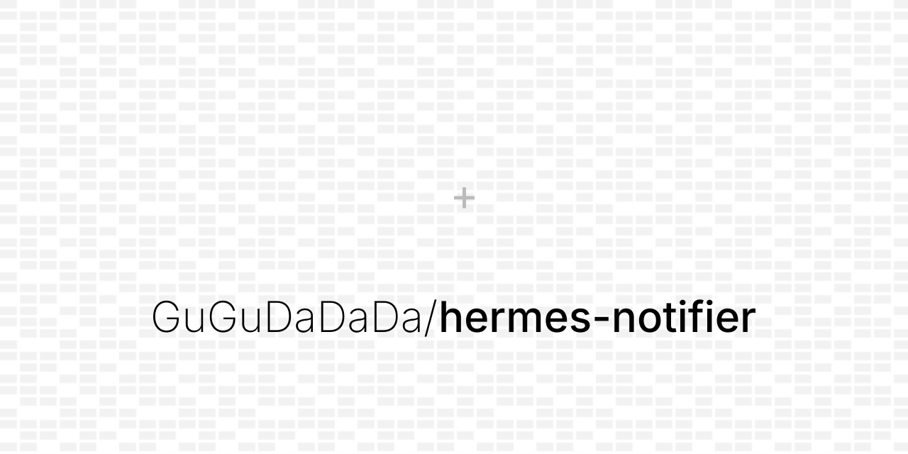

<div align="center">

# hermes-notifier



**Hermes Agent 主动提醒与事项追踪插件**

[](./LICENSE)
[](#)

</div>

---

## 简介

`hermes-notifier`（插件标识 `proactive`）是受[Muse](https://muse.ai/)的主动提醒功能启发，专为 Hermes Agent 打造的后台主动提醒与事项推进引擎。它在用户跨端（IM、Desktop、CLI、TUI）的日常交互中捕获未闭环事项，并在合适时机主动跟进并通知用户。

`hermes-notifier` 借鉴 Muse 的生产实践，采用后台进程对候选事件调研并由主 Agent 逐条复核；发送失败自动回滚重审，确保提醒精准、安静、不遗漏。`hermes-notifier`可以在不污染模型长期记忆，让 Agent 具备可靠的时效洞察与事项闭环能力。

## 快速开始

### 1. 挂载并启用插件

```bash
# 挂载到 Hermes 插件目录（推荐软链以便同步更新）
mkdir -p ~/.hermes/plugins
ln -sfn "$(pwd)/plugins/proactive" ~/.hermes/plugins/proactive

# 启用插件并运行契约校验
hermes plugins enable proactive
hermes plugins doctor ~/.hermes/plugins/proactive --ci
```

### 2. 一键配置定时任务

```bash
# 自动生成前置预检脚本并注册 Cron 调度（默认每个工作时段运行，跟随宿主时区）
hermes proactive setup-cron
```

完成后，插件已处于静默待命状态。你可以在日常会话中直接说“帮我跟进一下软考报名”，或者在终端运行：

```bash
hermes proactive status
```

## 工作方式

`hermes-notifier`采用采用三阶段构建候选时间的筛选与通知发送：

1. **Stage 1 确定性快照构建**：纯 Python 执行（0 Token）。检查活跃时间窗（默认 09:00–21:30），提取对话差分与待办状态；无增量时直接短路退出。
2. **Stage 2 分片只读调研**：轻量 Worker 分片分析对话增量与时效节点，汇总候选证据包；若无可提醒事项，直接提交检查点并静默退出。
3. **Stage 3 编辑门主 Agent 复核**：当且仅当存在高价值候选时唤醒主 Agent。主 Agent 读取实时对话增量与偏好约束，逐条裁定发送或跳过，重写为自然短句投递回原始会话。

## 常用操作

插件支持终端 CLI、会话内斜杠命令（`/proactive`）及 Agent 原生工具三种形态，保持完全统一的底层状态库：

### 终端管理

```bash
# 查看当前检查点水位、跟进事项与最近一期决策
hermes proactive status

# 查看历史版本的决策明细与投递记录
hermes proactive history

# 手动管理追踪事项
hermes proactive track list
hermes proactive track add exam-notice --title "软考报名通知" --description "跟进考区公布时间" --summary "尚未出公告"
hermes proactive track close exam-notice --summary "已完成报名与缴费"

# 强制触发一次完整预检
hermes proactive tick --force
```

### 聊天窗口交互

在 IM（如飞书）、Desktop 或 CLI 会话中直接输入：

```text
/proactive status
/proactive track list
/proactive track close exam-notice --summary "已办结"
```

## 偏好与防打扰

你可以通过配置文件定义 Agent 的行为边界：

- **自然语言偏好（`<HERMES_HOME>/PROACTIVE_PREFERENCES.md`）**：定义活跃时间窗、语气风格（如克制、简洁）、合并发送规则以及不干扰特定已有 Cron 任务的约束。
- **参数化配置（Desktop Settings / `config.yaml`）**：在 Hermes Desktop 的 **Settings → Plugins → proactive** 中可调整 `active_window`、`timezone`、`retention_days`（快照保留天数，默认 14 天）、`memory_source` 等运行参数。

## 开发与验证

```bash
# 运行完整自动化测试（104 个用例）
python3 -m unittest discover -s tests -v

# 执行 Hermes 官方插件规范自检
hermes plugins doctor plugins/proactive --ci
```

## 许可证

本项目基于 [MIT 许可证](./LICENSE) 开源。

## 关于作者

由 [GuGuDaDaDa](https://github.com/GuGuDaDaDa) 与 [Aier](https://github.com/GuGuDaDaDa) 联合构建，专注于提供高可靠、低干扰的 Agent 生产级工程实践。
